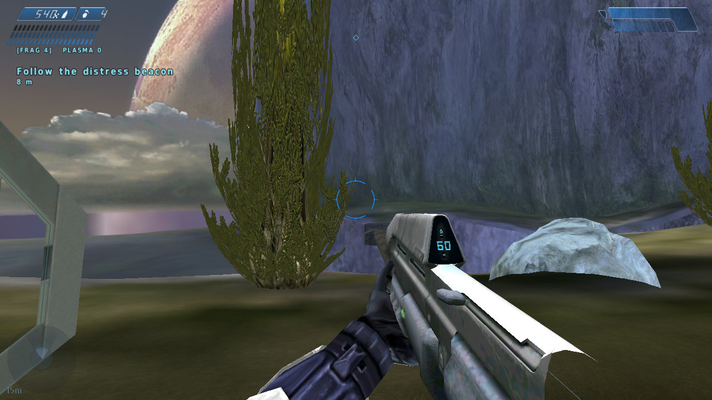
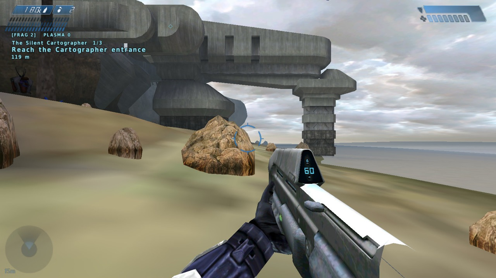
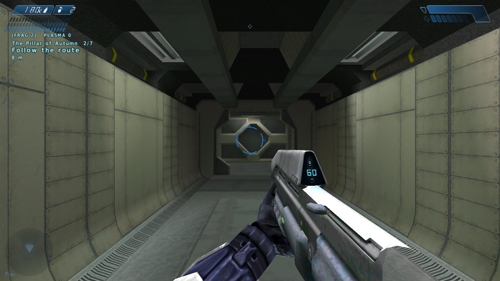
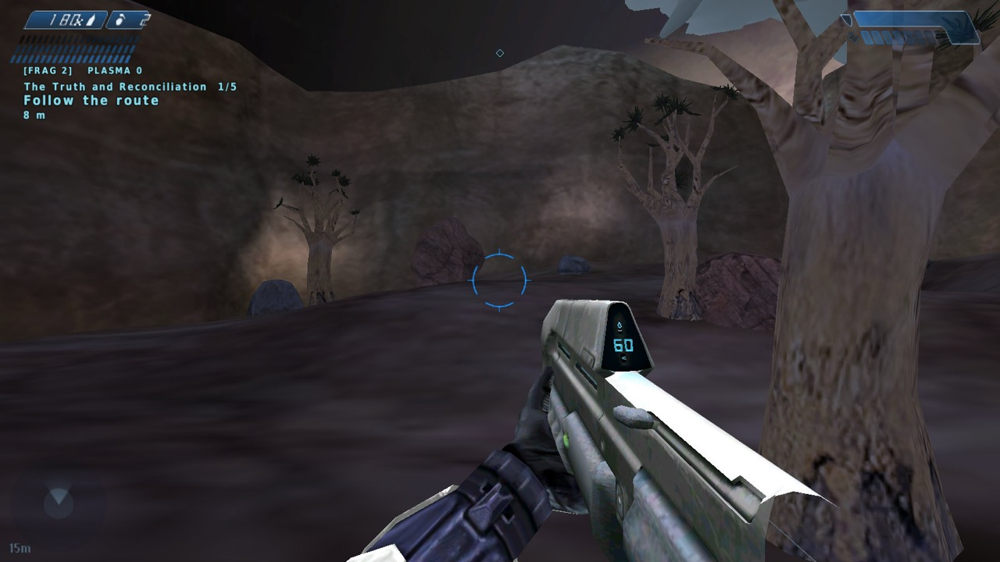
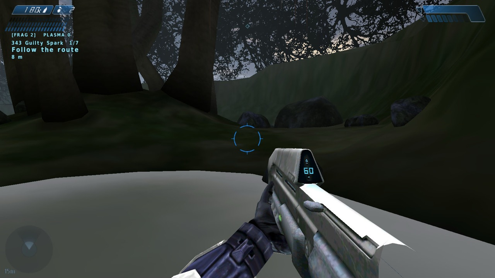
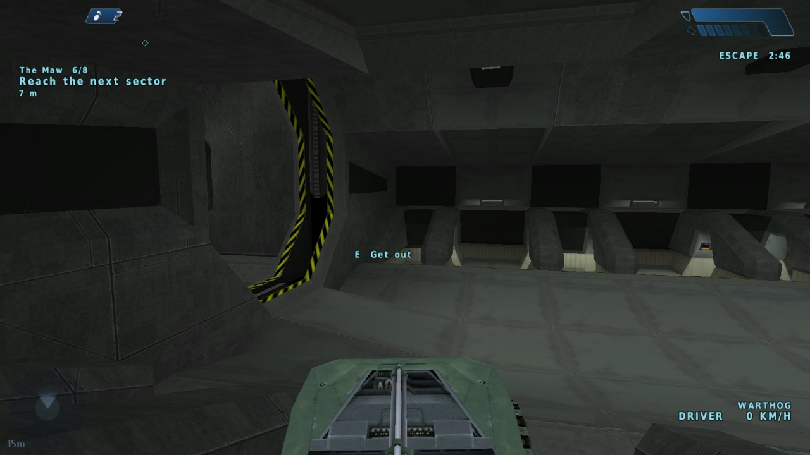

# HaloCube1: Halo in AssaultCube

The *Halo: Combat Evolved* campaign rebuilt on the open-source [AssaultCube](https://assault.cubers.net/) 1.3.0.2 engine, for Apple Silicon Macs. It runs from **The Pillar of Autumn** to **The Maw** as 55 linked sections. The levels are the original Xbox BSP geometry, textures and lighting; the original compiled HaloScript drives each mission; AssaultCube supplies the renderer, the movement and the engine underneath.

This is an unofficial, non-commercial fan project and a work in progress. **The repository contains no Halo game data.** Everything from Halo is generated on your own Mac from a copy of the Xbox game that you own (see [NOTICE.md](NOTICE.md)).

| | |
| --- | --- |
|  |  |
| *Halo: the lifepod crash site* | *The Silent Cartographer: the beach* |
|  |  |
| *The Pillar of Autumn* | *The Truth and Reconciliation* |
|  |  |
| *343 Guilty Spark: the swamp* | *The Maw: the Warthog run, with its countdown* |

The screenshots are from the game running with locally imported assets.

## What has been built

**The campaign.** All ten missions, split into 55 sections that load one after another, with checkpoints, four difficulties, a title menu, mission select and a saved game that resumes the mission script where you left it. The game ends with the Maw escape and credits.

**The levels.** An importer reads the Xbox map files and converts each level's structure BSP, textures, lightmaps and scenery into AssaultCube maps and models. The player and the AI collide with Halo's own collision geometry, not an approximation: all 55 sections use it (50 on foot, 3 driven in the Warthog, 2 flown in the Banshee), including about 4,100 scenery objects.

**The scripts.** A HaloScript importer and interpreter run the original mission scripts: objectives, trigger volumes, doors, lifts and other devices, enemy and ally placement, cutscenes, music and dialogue cues. Cutscenes use the original camera paths, scene geometry, cast models, animation clips and audio.

**Combat.** The nine campaign weapons, frag and plasma grenades, equipment and powerups are built from Halo's own tag data (rates of fire, damage, projectiles, heat, zoom). Damage follows Halo's rules on both sides: shields and health per unit type, each weapon's effect on each material, headshots, melee, falling damage, and the difficulty table that scales enemies, allies and the player.

**Enemies and allies.** Covenant (Grunts, Jackals, Elites, Hunters), Flood (infection, combat and carrier forms), Sentinels, the Monitor and the marines, with squads, firing positions, factions and allegiances from the scenario data. Their behaviour comes from the game's actor tags: fire rates and accuracy by difficulty, grenade throws, melee charges, dodging grenades and vehicles, berserk Elites, panicking Grunts, and Halo's own voice lines.

**Vehicles.** The Warthog, Ghost, Scorpion, Banshee and gun turrets for the player, and those plus the Wraith for the AI, with seats, vehicle weapons and destruction.

**The HUD.** Halo's HUD with shield and health meters, weapon and grenade counters, the motion tracker, objectives and nav points.

**Tooling.** Python importers under `tools/` for maps, collision, models, animations, audio, scripts, actors, weapons, vehicles and effects; a test client (`halo-ac-qa`) that drives the game without showing a window; about sixty test scripts; and checks that keep retail data out of the repository.

## Status

Honest summary: the campaign loads and plays from start to finish in automated runs, but it is not yet a polished game.

- A long stretch of work on fidelity (difficulty rules, the damage model, AI behaviour, voices) was written and compiled without being run in the game. It is listed change by change in [docs/unverified-changes.md](docs/unverified-changes.md).
- The first hands-on play-test of that work (The Pillar of Autumn, section 1) found real problems, now being fixed: crew members drawn with the marine model, an ally running into a wall during a scripted move, doors that did not open, tutorial text that leaves out the key to press, and Captain Keyes drawn without eyes in a cutscene.
- Movement, vehicle handling and AI navigation are AssaultCube's, tuned toward Halo, not a recreation of Halo's physics.
- Single-player only. Co-op, multiplayer and splitscreen are out of scope.

[docs/macos-build.md](docs/macos-build.md#status) has the per-section status table.

## Running it

You need an Apple Silicon Mac, the Xcode command-line tools, Homebrew packages (`cmake sdl2-compat sdl2_image libvorbis libogg ffmpeg`), the AssaultCube 1.3 release archive for its stock data, and the expanded map files from an Xbox copy of *Halo: Combat Evolved* that you own. The [build and import guide](docs/macos-build.md) has the exact steps.

```bash
./scripts/import-macos-assets.sh "<your Halo maps folder>"   # generate the git-ignored game data
./scripts/build-macos.sh && ./scripts/play-macos.sh          # build and play
./scripts/package-macos.sh                                   # build a relocatable .app for local use
./scripts/test-macos.sh [--slow] [--release]                 # build, package, run the tests
```

The game opens on the title menu: **Continue** resumes at the last checkpoint, **New Game** asks for a difficulty and starts The Pillar of Autumn, and **Mission select** lists the missions reached so far.

| Input | Action |
| --- | --- |
| W A S D, mouse | Move and aim; in a vehicle, throttle and steer (the Banshee strafes with A and D) |
| Space, Left Shift | Jump and crouch; in a Banshee, climb and descend |
| Left click, R | Fire and reload; in a vehicle's gun seat or at a Ghost's, Scorpion's or Banshee's controls, fire its gun |
| Q or 1 / 2 | Switch between your two carried weapons |
| Mouse 2 or Z | Zoom (pistol, sniper rifle, rocket launcher); in a vehicle, its second trigger |
| G, H | Throw a grenade, switch between frag and plasma grenades |
| F | Melee |
| X | Flashlight |
| E | Use a control, swap for a weapon on the ground, get in or out of a vehicle, flip one back, board a landed Pelican |
| Enter | Skip the current cutscene or continue after completing a section |
| Esc, F5 | Pause or restart the current section |
| F8 | Edit mode (fly through the level; scripts pause) |
| Left click after death | Revert to the most recent checkpoint |

## Repository layout

| Path | Contents |
| --- | --- |
| `source/` | The AssaultCube 1.3.0.2 engine source with the Halo campaign code (`source/src/halo*.cpp`) |
| `tools/` | Python importers that turn the Xbox map files into maps, models, audio, scripts and tables |
| `config/` | Game configuration, menus and key bindings |
| `scripts/` | Build, import, play, package and test scripts for macOS |
| `tests/` | The test scripts and the hooks compiled into the test client |
| `docs/` | The build guide, the record of unverified changes and the screenshots |

## Legal

Unofficial fan project, not affiliated with or endorsed by Microsoft, Xbox Game Studios, 343 Industries, Bungie or the AssaultCube project. "Halo" and related names, characters and artwork belong to their owners. The engine is AssaultCube (zlib-style licence); see [NOTICE.md](NOTICE.md) for the full notices.

[Build and asset import guide](docs/macos-build.md) · [Changes not yet run in the game](docs/unverified-changes.md) · [Tests](tests/README.md) · [Notice](NOTICE.md)
